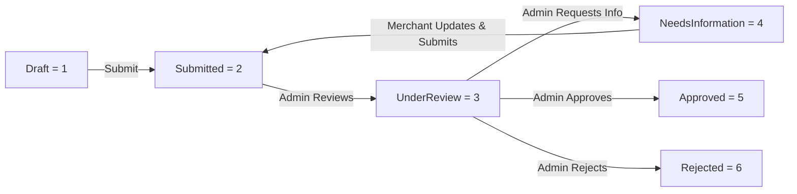
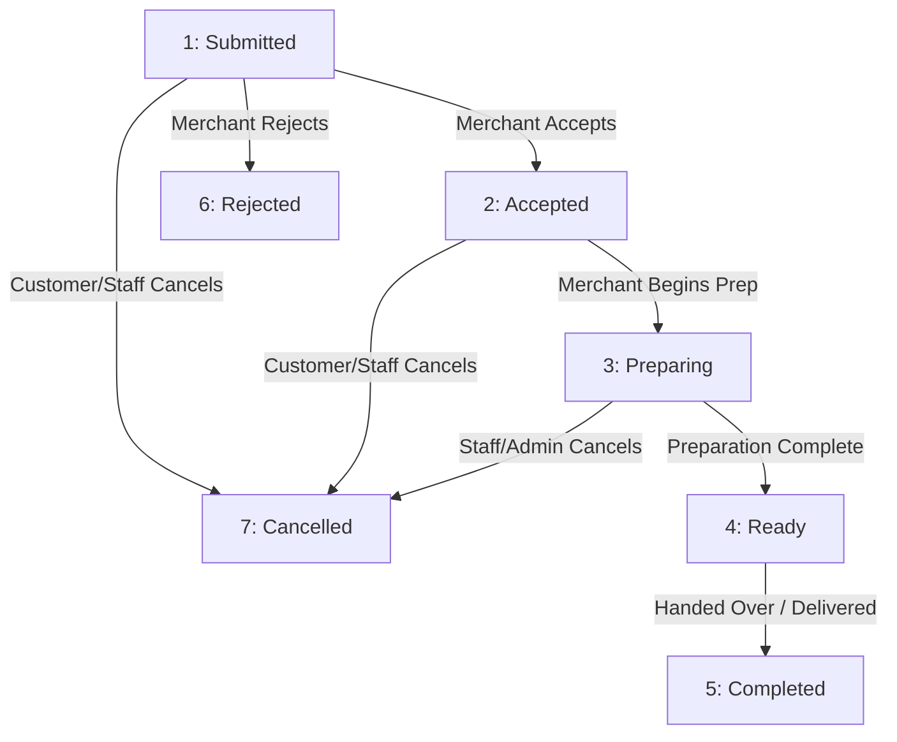

# DawwerOS Web API - Machine-Readable Documentation for AI Agents & Developers

Comprehensive, structured API reference designed for AI Agents, LLM tools, frontend clients, and service integrations interacting with the **DawwerOS Web API**.

---

## 1. System Overview & Core Specifications

- **Protocol**: `HTTPS` (Strict. Always use `HTTPS` to avoid browser CORS preflight redirects).
- **Base URLs**:
  - **Production / Staging**: `https://dawwer.runasp.net/api`
  - **Local Development**: `https://localhost:7212/api` (or `http://localhost:5037/api`)
- **Default Content-Type**: `application/json; charset=utf-8` (document and receipt uploads use `multipart/form-data`).
- **Interactive Swagger Explorer**:
  - Production: `https://dawwer.runasp.net/swagger`
  - Local: `https://localhost:7212/swagger`
  - Note: The root URL (`/`) automatically redirects to `/swagger`.
- **Hangfire Dashboard**:
  - Production: `https://dawwer.runasp.net/hangfire`
  - Local: `https://localhost:7212/hangfire`
- **CORS Configuration**: Supports all origins with credentials, all headers, and standard HTTP methods (`GET`, `POST`, `PUT`, `PATCH`, `DELETE`, `OPTIONS`).
- **Rate Limiting (`AuthRateLimit`)**:
  - Production: 30 requests/minute per IP.
  - Development: 200 requests/minute per IP.
  - Exceeding limit returns `429 Too Many Requests`.

---

## 2. Universal API Envelope (`ApiResponse<T>`)

Every endpoint across the entire API returns a standardized JSON envelope. Clients and agents must parse this wrapper to verify success and read the payload or error details.

### Success Response Envelope
```json
{
  "success": true,
  "message": "Operation completed successfully.",
  "data": { ... },
  "errors": null
}
```

### Failure / Validation Response Envelope
```json
{
  "success": false,
  "message": "Validation failed.",
  "data": null,
  "errors": [
    "Email address is required.",
    "Password must contain at least one uppercase letter, one lowercase letter, one digit, and one special character."
  ]
}
```

### HTTP Status Code Semantics
- `200 OK`: Request succeeded. Envelope contains `data`.
- `201 Created`: Resource successfully created. Returns resource details and `Location` header when applicable.
- `400 Bad Request`: Payload validation failed or business rule violated. Check `message` and `errors`.
- `401 Unauthorized`: Missing, expired, or revoked JWT Bearer token.
- `403 Forbidden`: Authenticated user lacks required platform role or store permission.
- `404 Not Found`: Target entity does not exist or user lacks access rights.
- `409 Conflict`: Business lock / reservation conflict (e.g. attempting to mix items from different stores in a cart, or reserving an already-reserved cart).
- `410 Gone`: Resource expired (e.g. customer amendment response window expired after 2 hours).
- `429 Too Many Requests`: Client exceeded the rate limit window.
- `500 Internal Server Error`: Unhandled server exception.

---

## 3. Authentication, Tokens & Authorization

### 3.1 Authentication Mechanism
- Standard **JWT Bearer Token** passed in the HTTP `Authorization` header:
  ```http
  Authorization: Bearer <accessToken>
  ```
- **Token Invalidation**: Server maintains a revocation list by `jti` (JWT ID). Tokens are also invalidated upon logout, account suspension, or password changes.
- **Refresh Flow**: Refresh tokens are single-use / rotated to renew expired access tokens without re-authenticating credentials.

### 3.2 User Roles (`UserRole`)
| Role | Integer Value | Description |
|---|---|---|
| `Customer` | `1` | End consumers who browse products, place orders, and manage personal profile. |
| `Merchant` | `2` | Business owners who create store applications, manage stores, and assign staff. |
| `Staff` | `3` | Store employees assigned to a merchant's store with fine-grained permissions. |
| `Admin` | `4` | Platform operators with global governance, store review, taxonomy, and audit oversight. |

### 3.3 User Account Status (`UserStatus`)
| Status | Integer Value | Description |
|---|---|---|
| `PendingVerification` | `1` | Newly registered; requires 6-digit email verification code. |
| `Active` | `2` | Fully verified and active. |
| `Suspended` | `3` | Blocked by platform admin; active JWT tokens rejected. |
| `Inactive` | `4` | Deactivated by user or system. |

### 3.4 Multi-Tenant Store Context Switching (`SelectStore`)
When an authorized user (`Merchant` or `Staff`) operates on a specific store, they call `POST /api/Auth/select-store` with `{ "storeId": "<guid>" }`.
The backend issues a store-scoped token embedding:
- `storeId`: Active Store GUID
- `storePermissions`: Comma-separated granular permission codes granted to the user in that store.

### 3.5 Fine-Grained Store Permissions (`StorePermissions`)
Used with the `[RequireStorePermission(...)]` attribute on store-scoped endpoints:
- `Products.View`: View products and inventory in the store.
- `Products.Manage`: Create, update, or delete products.
- `Inventory.View`: View stock levels and inventory alerts.
- `Inventory.Manage`: Adjust stock, track warehouses, and manage lots.
- `Orders.View`: Inspect customer orders and fulfillment states.
- `Orders.Manage`: Update order status, process refunds, and propose amendments.
- `Orders.PaymentReview`: Review and verify customer offline payment receipts and approve/reject transactions.
- `Staff.Manage`: Invite, update, remove staff, and manage custom roles.
- `Store.Manage`: Modify store branding, settings, delivery zones, and business metadata.

---

## 4. Complete Endpoint Reference

### 4.1 Authentication & Identity (`/api/Auth`)

| Method | Endpoint | Auth | Description |
|---|---|---|---|
| `POST` | `/api/Auth/register` | Anonymous | Registers a new Customer or Merchant. Dispatches 6-digit verification code. |
| `POST` | `/api/Auth/verify-code` | Anonymous | Verifies account using 6-digit code. Returns user profile & JWT tokens upon success. |
| `POST` | `/api/Auth/resend-code` | Anonymous | Re-sends verification code. |
| `POST` | `/api/Auth/login` | Anonymous | Authenticates with email & password. Returns JWT + refresh token. |
| `POST` | `/api/Auth/refresh-token` | Anonymous | Exchanges refresh token for new access & refresh tokens. |
| `GET` | `/api/Auth/me` | Bearer Token | Retrieves current user claims and identity context from JWT. |
| `POST` | `/api/Auth/forgot-password` | Anonymous | Sends password reset token to user's registered email. |
| `POST` | `/api/Auth/reset-password` | Anonymous | Resets password using verification token. |
| `POST` | `/api/Auth/logout` | Bearer Token | Revokes JWT `jti` and invalidates active refresh tokens. Optional body: `{ refreshToken, logoutAllDevices }`. |
| `POST` | `/api/Auth/select-store` | Bearer Token | Switches active store context and issues store-scoped JWT token. |

#### Request & Response Schemas:

##### `POST /api/Auth/register`
- **Request Body**:
  ```json
  {
    "fullName": "Ahmed Ali",
    "email": "ahmed@example.com",
    "phoneNumber": "+966501234567",
    "password": "StrongPassword123!",
    "role": 1
  }
  ```
  *Validation Rules*:
  - `fullName`: Required, 2-100 characters.
  - `email`: Required, valid email format, max 256 characters.
  - `phoneNumber`: Optional, valid phone format, max 30 characters.
  - `password`: Required, min 8 characters, must include 1 uppercase, 1 lowercase, 1 number, 1 special character (`^(?=.*[a-z])(?=.*[A-Z])(?=.*\d)(?=.*[\W_]).+$`).
  - `role`: Optional (Default: `1` Customer, `2` Merchant).
- **Response `data` (`RegisterResponseDto`)**:
  ```json
  {
    "userId": "3fa85f64-5717-4562-b3fc-2c963f66afa6",
    "fullName": "Ahmed Ali",
    "email": "ahmed@example.com",
    "phoneNumber": "+966501234567",
    "role": "Customer",
    "status": "PendingVerification",
    "isEmailVerified": false,
    "message": "User registered successfully. Verification code dispatched.",
    "verificationCodePreview": "123456"
  }
  ```

##### `POST /api/Auth/verify-code`
- **Request Body**:
  ```json
  {
    "email": "ahmed@example.com",
    "code": "123456",
    "codeType": 1
  }
  ```
  *Enums (`VerificationCodeType`)*: `EmailVerification = 1`, `PhoneVerification = 2`, `PasswordReset = 3`.
- **Response `data` (`VerifyCodeResponseDto`)**:
  ```json
  {
    "success": true,
    "message": "Account verified successfully.",
    "authData": {
      "userId": "3fa85f64-5717-4562-b3fc-2c963f66afa6",
      "fullName": "Ahmed Ali",
      "email": "ahmed@example.com",
      "phoneNumber": "+966501234567",
      "role": "Customer",
      "accessToken": "eyJhbGciOi...",
      "refreshToken": "d8a7c2b4...",
      "expiresAt": "2026-10-01T20:30:00Z"
    }
  }
  ```

##### `POST /api/Auth/resend-code`
- **Request Body**:
  ```json
  {
    "email": "ahmed@example.com",
    "type": 1
  }
  ```
- **Response `data`**: `true`

##### `POST /api/Auth/login`
- **Request Body**:
  ```json
  {
    "email": "ahmed@example.com",
    "password": "StrongPassword123!"
  }
  ```
- **Response `data` (`AuthResponseDto`)**:
  ```json
  {
    "userId": "3fa85f64-5717-4562-b3fc-2c963f66afa6",
    "fullName": "Ahmed Ali",
    "email": "ahmed@example.com",
    "phoneNumber": "+966501234567",
    "role": "Customer",
    "accessToken": "eyJhbGciOi...",
    "refreshToken": "d8a7c2b4...",
    "expiresAt": "2026-10-01T20:30:00Z"
  }
  ```

##### `POST /api/Auth/refresh-token`
- **Request Body**:
  ```json
  {
    "accessToken": "eyJhbGciOi...",
    "refreshToken": "d8a7c2b4..."
  }
  ```
- **Response `data`**: Same as `AuthResponseDto`.

##### `GET /api/Auth/me`
- **Response `data`**:
  ```json
  {
    "userId": "3fa85f64-5717-4562-b3fc-2c963f66afa6",
    "email": "ahmed@example.com",
    "fullName": "Ahmed Ali",
    "status": "Active",
    "roles": ["Customer"]
  }
  ```

##### `POST /api/Auth/forgot-password`
- **Request Body**:
  ```json
  {
    "email": "ahmed@example.com"
  }
  ```
- **Response `data` (`ForgotPasswordResponseDto`)**:
  ```json
  {
    "success": true,
    "message": "Password reset token sent to your email.",
    "resetTokenPreview": "preview-token-if-non-prod"
  }
  ```

##### `POST /api/Auth/reset-password`
- **Request Body**:
  ```json
  {
    "email": "ahmed@example.com",
    "token": "reset-token-here",
    "newPassword": "NewStrongPassword456!",
    "confirmPassword": "NewStrongPassword456!"
  }
  ```
- **Response `data`**: `true`

##### `POST /api/Auth/logout`
- **Request Body** (Optional):
  ```json
  {
    "refreshToken": "d8a7c2b4...",
    "logoutAllDevices": false
  }
  ```
- **Response `data`**: `true`

##### `POST /api/Auth/select-store`
- **Request Body**:
  ```json
  {
    "storeId": "7b8f6a91-45c2-48df-bc88-825dfa234123"
  }
  ```
- **Response `data` (`SelectStoreResponseDto`)**:
  ```json
  {
    "accessToken": "eyJhbGciOi...",
    "tokenType": "Bearer",
    "expiresInMinutes": 1440,
    "storeId": "7b8f6a91-45c2-48df-bc88-825dfa234123",
    "storeName": "Green Tech Store",
    "roleName": "Store Manager",
    "effectivePermissions": [
      "Products.View",
      "Products.Manage",
      "Inventory.View",
      "Inventory.Manage",
      "Orders.View",
      "Orders.Manage",
      "Orders.PaymentReview",
      "Staff.Manage",
      "Store.Manage"
    ]
  }
  ```

---

### 4.2 Authenticated User Profile (`/api/Profile`)

Requires `Authorization: Bearer <token>`.

| Method | Endpoint | Description |
|---|---|---|
| `GET` | `/api/Profile` | Retrieves authenticated user profile details. |
| `PUT` | `/api/Profile` | Updates editable profile fields (`fullName`, `email`, `phoneNumber`). |
| `POST` | `/api/Profile/change-password` | Changes password. Invalidates all existing sessions. |

#### Request & Response Schemas:

##### `GET /api/Profile`
- **Response `data` (`UserProfileResponseDto`)**:
  ```json
  {
    "userId": "3fa85f64-5717-4562-b3fc-2c963f66afa6",
    "fullName": "Ahmed Ali",
    "email": "ahmed@example.com",
    "phoneNumber": "+966501234567",
    "role": "Customer",
    "status": "Active",
    "isEmailVerified": true,
    "emailVerifiedAt": "2026-09-15T12:00:00Z",
    "isPhoneVerified": false,
    "phoneVerifiedAt": null,
    "lastLoginAt": "2026-10-01T18:00:00Z",
    "createdAt": "2026-09-15T11:50:00Z",
    "updatedAt": "2026-09-20T10:15:00Z"
  }
  ```

##### `PUT /api/Profile`
- **Request Body**:
  ```json
  {
    "fullName": "Ahmed Ali Updated",
    "email": "ahmed.new@example.com",
    "phoneNumber": "+966509999999"
  }
  ```

##### `POST /api/Profile/change-password`
- **Request Body**:
  ```json
  {
    "currentPassword": "OldPassword123!",
    "newPassword": "NewStrongPassword456!",
    "confirmPassword": "NewStrongPassword456!"
  }
  ```
- **Response `data`**: `true`

---

### 4.3 Public Catalog & Store Discovery

#### 4.3.1 Public Categories (`/api/categories`)
| Method | Endpoint | Auth | Description |
|---|---|---|---|
| `GET` | `/api/categories` | Anonymous | Get flat list of active categories. Query: `search`. |
| `GET` | `/api/categories/tree` | Anonymous | Get full active category hierarchy tree. |
| `GET` | `/api/categories/{id}` | Anonymous | Get active category details by GUID. |

##### Category Tree Response Item (`CategoryTreeResponseDto`):
```json
{
  "id": "e4f8d2a1-62d9-4fa2-9387-578b1234abcd",
  "name": "Electronics",
  "description": "Electronic devices and accessories",
  "iconUrl": "https://assets.dawwer.com/icons/electronics.svg",
  "isActive": true,
  "displayOrder": 1,
  "parentCategoryId": null,
  "children": [
    {
      "id": "c1a2b3d4-62d9-4fa2-9387-578b1234abcd",
      "name": "Smartphones",
      "description": "Mobile phones and tablets",
      "iconUrl": "https://assets.dawwer.com/icons/smartphones.svg",
      "isActive": true,
      "displayOrder": 1,
      "parentCategoryId": "e4f8d2a1-62d9-4fa2-9387-578b1234abcd",
      "children": []
    }
  ]
}
```

#### 4.3.2 Public Stores (`/api/stores`)
| Method | Endpoint | Auth | Description |
|---|---|---|---|
| `GET` | `/api/stores` | Anonymous | Browse approved/active stores. Query: `city`, `search`, `page` (def 1), `pageSize` (def 20). |
| `GET` | `/api/stores/{id}` | Anonymous | Get public store details. Returns 404 if inactive or not approved. |

##### Public Store Response Item (`PublicStoreResponseDto`):
```json
{
  "id": "7b8f6a91-45c2-48df-bc88-825dfa234123",
  "name": "Al-Amal Electronics",
  "description": "Authorized dealer for smart devices",
  "phoneNumber": "+966112223344",
  "email": "info@alamal.com",
  "address": "King Fahd Road, Riyadh",
  "city": "Riyadh",
  "latitude": 24.7136,
  "longitude": 46.6753,
  "logoUrl": "https://assets.dawwer.com/logos/alamal.png",
  "coverImageUrl": "https://assets.dawwer.com/covers/alamal.png",
  "status": "Active"
}
```

---

### 4.4 Merchant Store Application & Management (`/api/merchant/stores`)

Requires `Authorize(Roles = "Merchant,Admin")`.

| Method | Endpoint | Description |
|---|---|---|
| `POST` | `/api/merchant/stores` | Create a new draft store application. |
| `PUT` | `/api/merchant/stores/{id}` | Update application while in `Draft` or `NeedsInformation` status. |
| `GET` | `/api/merchant/stores` | List all applications belonging to the authenticated merchant. |
| `GET` | `/api/merchant/stores/{id}` | Get application details by GUID. |
| `POST` | `/api/merchant/stores/{id}/documents` | Upload required verification document (`multipart/form-data`). |
| `DELETE` | `/api/merchant/stores/{id}/documents/{documentId}` | Delete an uploaded document from draft application. |
| `POST` | `/api/merchant/stores/{id}/submit` | Submit draft application for admin review. |

#### Store Verification Lifecycle (`StoreVerificationStatus`):


#### Document Types (`StoreDocumentType`):
- `1` = `CommercialRegister`
- `2` = `TaxCard`
- `3` = `StoreLicense`
- `4` = `IdentityDocument`
- `5` = `Other`

#### Request Schemas:
##### `POST /api/merchant/stores` / `PUT /api/merchant/stores/{id}`
```json
{
  "name": "Al-Amal Electronics",
  "description": "Authorized dealer for smart devices",
  "commercialRegistrationNumber": "1010123456",
  "taxNumber": "300012345600003",
  "phoneNumber": "+966112223344",
  "email": "info@alamal.com",
  "address": "King Fahd Road, Riyadh",
  "city": "Riyadh",
  "latitude": 24.7136,
  "longitude": 46.6753,
  "logoUrl": "https://assets.dawwer.com/logos/alamal.png",
  "coverImageUrl": "https://assets.dawwer.com/covers/alamal.png"
}
```

##### `POST /api/merchant/stores/{id}/documents`
- `Content-Type`: `multipart/form-data`
- Form fields:
  - `file`: binary file payload (PDF, PNG, JPG)
  - `documentType`: integer (e.g. `1` for CommercialRegister)

---

### 4.5 Store Staff & Custom Roles (`/api/stores/{storeId}/...`)

Requires `Authorize(Roles = "Admin,Merchant,Staff")`.

#### 4.5.1 Staff Management (`/api/stores/{storeId}/staff`)
Requires `RequireStorePermission(StorePermissions.ManageStaff)`.

| Method | Endpoint | Description |
|---|---|---|
| `GET` | `/api/stores/{storeId}/staff` | List staff members assigned to this store. |
| `POST` | `/api/stores/{storeId}/staff` | Invite/add a new staff member to this store. |
| `GET` | `/api/stores/{storeId}/staff/{staffId}` | Get staff member details. |
| `PUT` | `/api/stores/{storeId}/staff/{staffId}` | Update staff role, status (`Active=1`, `Suspended=2`, `Inactive=3`), or custom permissions. |
| `DELETE` | `/api/stores/{storeId}/staff/{staffId}` | Remove staff member from the store. |
| `POST` | `/api/stores/{storeId}/staff/{staffId}/role` | Assign or switch staff role. Body: `{ "storeRoleId": "<guid>" }`. |

##### Add Staff Member Payload (`AddStoreStaffRequestDto`):
```json
{
  "email": "employee@store.com",
  "fullName": "Salim Mansour",
  "phoneNumber": "+966551122334",
  "storeRoleId": "91a82f34-11bc-4981-b203-883a9921ef10",
  "temporaryPassword": "TempPassword123!",
  "customGrantedPermissions": ["Orders.Manage", "Orders.PaymentReview"],
  "customRevokedPermissions": ["Staff.Manage"]
}
```

#### 4.5.2 Store Roles & Permissions (`/api/stores/{storeId}/roles`)
| Method | Endpoint | Permission | Description |
|---|---|---|---|
| `GET` | `/api/stores/{storeId}/roles` | RequireStorePermission | Get all system presets and custom store roles. |
| `POST` | `/api/stores/{storeId}/roles` | Staff.Manage | Create a custom role with selected permissions. |
| `PUT` | `/api/stores/{storeId}/roles/{roleId}` | Staff.Manage | Update an existing custom store role. |
| `GET` | `/api/stores/{storeId}/roles/permissions` | RequireStorePermission | Get catalog of all granular permission codes for UI matrices. |

##### Create Store Role Payload (`CreateStoreRoleRequestDto`):
```json
{
  "name": "Order Dispatcher & Cashier",
  "description": "Responsible for managing orders and reviewing offline payment receipts",
  "permissionCodes": [
    "Orders.View",
    "Orders.Manage",
    "Orders.PaymentReview",
    "Inventory.View"
  ]
}
```

---

### 4.6 Shopping Cart & 15-Minute Checkout Stock Hold (`/api/Cart`, `/api/Checkout`)

Requires `Authorize`. Manages single-store shopping carts and reserves inventory atomically for 15 minutes during checkout.

#### 4.6.1 Cart Management (`/api/Cart`)
| Method | Endpoint | Description |
|---|---|---|
| `GET` | `/api/Cart` | Retrieve current customer's active cart. Returns 404 if empty. |
| `POST` | `/api/Cart` | Add or update an item in cart. Body: `{ storeId, productId, quantity }`. Returns `409 Conflict` if trying to add an item from another store (single-store cart rule). |
| `DELETE` | `/api/Cart` | Clear entire active cart. |
| `DELETE` | `/api/Cart/items/{productId}` | Remove specific item from cart. |

##### Add to Cart Payload (`AddToCartRequestDto`):
```json
{
  "storeId": "7b8f6a91-45c2-48df-bc88-825dfa234123",
  "productId": "4ca96f72-91f1-43ef-92e1-872ab6721092",
  "quantity": 2
}
```

##### Cart Details Response (`CartDto`):
```json
{
  "id": "1a2b3c4d-5e6f-7a8b-9c0d-1e2f3a4b5c6d",
  "userId": "3fa85f64-5717-4562-b3fc-2c963f66afa6",
  "storeId": "7b8f6a91-45c2-48df-bc88-825dfa234123",
  "storeName": "Al-Amal Electronics",
  "lastActivityAtUtc": "2026-10-01T18:30:00Z",
  "totalItems": 2,
  "totalAmount": 500.00,
  "items": [
    {
      "id": "2b3c4d5e-6f7a-8b9c-0d1e-2f3a4b5c6d7e",
      "productId": "4ca96f72-91f1-43ef-92e1-872ab6721092",
      "productName": "Wireless Earbuds Pro",
      "sku": "EAR-PRO-001",
      "quantity": 2,
      "unitPriceSnapshot": 250.00,
      "totalPrice": 500.00,
      "imageUrl": "https://assets.dawwer.com/products/earbuds.png"
    }
  ]
}
```

#### 4.6.2 Checkout Reservation (`/api/Checkout`)
| Method | Endpoint | Description |
|---|---|---|
| `POST` | `/api/Checkout/reserve` | Initiates checkout and locks stock atomically for 15 minutes (900 seconds). Body: `{ cartId }`. |

##### Reserve Stock Request (`ReserveStockRequestDto`):
```json
{
  "cartId": "1a2b3c4d-5e6f-7a8b-9c0d-1e2f3a4b5c6d"
}
```

##### Reservation Response (`ReservationResponseDto`):
```json
{
  "reservationId": "8f7e6d5c-4b3a-2109-8765-4321fedcba98",
  "expiresAtUtc": "2026-10-01T18:45:00Z",
  "heldSeconds": 900
}
```
*Hangfire Lifecycle*: The system automatically schedules a delayed background job (`StockHoldSweeperJob`) that sweeps and releases held inventory if the reservation expires before order submission.

---

### 4.7 Municipal Delivery Zones & Fees (`/api/...`)

Catalogs municipal districts and manages store delivery zone fees and eligibility.

| Method | Endpoint | Auth | Description |
|---|---|---|---|
| `GET` | `/api/districts` | Anonymous | Get standardized platform district catalog. Optional Query: `city`. |
| `GET` | `/api/stores/{storeId}/delivery-zones` | Anonymous | List delivery zones configured by a store. |
| `POST` | `/api/stores/{storeId}/delivery-zones` | Authorize | Configure or update delivery district zone for a store. |
| `GET` | `/api/stores/{storeId}/delivery-zones/check` | Anonymous | Check delivery eligibility & fee for a district. Query: `districtId`. Returns 404 if not supported. |

#### Request & Response Schemas:

##### `GET /api/districts?city=Riyadh`
- **Response `data` (`List<DistrictDto>`)**:
  ```json
  [
    {
      "id": "e1f2a3b4-c5d6-7e8f-9a0b-1c2d3e4f5a6b",
      "nameEn": "Al-Olaya",
      "nameAr": "العليا",
      "cityEn": "Riyadh",
      "cityAr": "الرياض",
      "postalCode": "12211",
      "isActive": true
    }
  ]
  ```

##### `POST /api/stores/{storeId}/delivery-zones`
- **Request Body (`ConfigureDeliveryZoneRequestDto`)**:
  ```json
  {
    "districtId": "e1f2a3b4-c5d6-7e8f-9a0b-1c2d3e4f5a6b",
    "flatDeliveryFee": 25.00,
    "minimumOrderAmount": 50.00,
    "estimatedDeliveryMinutes": 60,
    "isActive": true
  }
  ```
- **Response `data` (`MerchantDeliveryZoneDto`)**:
  ```json
  {
    "id": "f2a3b4c5-d6e7-8f9a-0b1c-2d3e4f5a6b7c",
    "storeId": "7b8f6a91-45c2-48df-bc88-825dfa234123",
    "districtId": "e1f2a3b4-c5d6-7e8f-9a0b-1c2d3e4f5a6b",
    "districtNameEn": "Al-Olaya",
    "districtNameAr": "العليا",
    "cityEn": "Riyadh",
    "flatDeliveryFee": 25.00,
    "minimumOrderAmount": 50.00,
    "estimatedDeliveryMinutes": 60,
    "isActive": true
  }
  ```

##### `GET /api/stores/{storeId}/delivery-zones/check?districtId={districtId}`
- **Response `data` (`DeliveryZoneCheckResponseDto`)**:
  ```json
  {
    "isSupported": true,
    "flatDeliveryFee": 25.00,
    "estimatedDeliveryMinutes": 60,
    "minimumOrderAmount": 50.00
  }
  ```

---

### 4.8 Orders Lifecycle, State Machine & Amendments (`/api/Orders`)

Requires `Authorize`. Manages order placement, state transitions, customer consent for substitutions, and cancellation cutoffs.

| Method | Endpoint | Description |
|---|---|---|
| `POST` | `/api/Orders` | Submit order from active checkout reservation. Locks snapshot prices and delivery fee. Returns `201 Created`. |
| `GET` | `/api/Orders` | Query customer orders or store intake queue. Query: `storeId`, `status`. |
| `GET` | `/api/Orders/{id}` | Retrieve comprehensive order details with item snapshots, fulfillment snapshot, and status history. |
| `PATCH` | `/api/Orders/{id}/status` | Transition order status (`Submitted`, `Accepted`, `Preparing`, `Ready`, `Completed`, `Rejected`, `Cancelled`). |
| `POST` | `/api/Orders/{id}/cancel` | Customer or staff cancellation. Enforces pre-preparation cutoff (customer cannot cancel once `Preparing`). |
| `POST` | `/api/Orders/{id}/amendments` | Propose item substitutions or revised total (Merchant). Starts 2-hour customer consent window. |
| `POST` | `/api/Orders/{id}/amendments/{amendmentId}/respond` | Customer approves or rejects proposed amendment. Returns `410 Gone` if 2-hour window expired. |

#### Order Status Lifecycle (`OrderStatus`):

> [!IMPORTANT]
> **Pre-Preparation Cutoff Rule**: Once an order reaches `Preparing (3)`, customers can NO LONGER cancel the order via `/api/Orders/{id}/cancel` (returns `403 Forbidden`). Only store staff or admins can cancel preparing/ready orders.

#### Payment Status Lifecycle (`PaymentStatus`):
- `1` = `AwaitingPayment`
- `2` = `UnderReview`
- `3` = `EvidenceRejected`
- `4` = `Paid`
- `5` = `DueOnPickup`
- `6` = `DueOnDelivery`
- `7` = `RefundPending`
- `8` = `PartiallyRefunded`
- `9` = `Refunded`

#### Request & Response Schemas:

##### `POST /api/Orders`
- **Request Body (`SubmitOrderRequestDto`)**:
  ```json
  {
    "reservationId": "8f7e6d5c-4b3a-2109-8765-4321fedcba98",
    "fulfillmentType": 2,
    "pickupWindow": null,
    "deliveryAddress": {
      "districtId": "e1f2a3b4-c5d6-7e8f-9a0b-1c2d3e4f5a6b",
      "city": "Riyadh",
      "streetAddress": "Olaya Main Street",
      "buildingNumber": "42",
      "postalCode": "12211",
      "recipientPhone": "+966501112233",
      "deliveryInstructions": "Deliver to front reception"
    },
    "customerNotes": "Please call before arrival"
  }
  ```
  *Enums (`FulfillmentType`)*: `Pickup = 1`, `Delivery = 2`.

##### `GET /api/Orders/{id}` Response (`OrderDetailDto`):
```json
{
  "id": "9a8b7c6d-5e4f-3a2b-1c0d-9e8f7a6b5c4d",
  "orderNumber": "ORD-20261001-A1B2",
  "customerId": "3fa85f64-5717-4562-b3fc-2c963f66afa6",
  "customerName": "Ahmed Ali",
  "storeId": "7b8f6a91-45c2-48df-bc88-825dfa234123",
  "storeName": "Al-Amal Electronics",
  "status": 1,
  "paymentStatus": 1,
  "fulfillmentType": 2,
  "subtotalAmount": 500.00,
  "deliveryFee": 25.00,
  "totalAmount": 525.00,
  "currency": "SAR",
  "isSettlementEligible": true,
  "settlementHoldReason": null,
  "customerNotes": "Please call before arrival",
  "rejectionReason": null,
  "cancellationReason": null,
  "createdAt": "2026-10-01T18:40:00Z",
  "items": [
    {
      "id": "1b2c3d4e-...",
      "productId": "4ca96f72-91f1-43ef-92e1-872ab6721092",
      "productName": "Wireless Earbuds Pro",
      "sku": "EAR-PRO-001",
      "quantity": 2,
      "unitPrice": 250.00,
      "totalPrice": 500.00,
      "notes": null
    }
  ],
  "fulfillmentSnapshot": {
    "fulfillmentType": 2,
    "pickupWindowStart": null,
    "pickupWindowEnd": null,
    "districtId": "e1f2a3b4-c5d6-7e8f-9a0b-1c2d3e4f5a6b",
    "districtName": "Al-Olaya",
    "city": "Riyadh",
    "streetAddress": "Olaya Main Street",
    "buildingNumber": "42",
    "postalCode": "12211",
    "deliveryFee": 25.00,
    "recipientPhone": "+966501112233",
    "deliveryInstructions": "Deliver to front reception"
  },
  "statusHistory": [
    {
      "id": "2c3d4e5f-...",
      "previousStatus": 1,
      "newStatus": 1,
      "changedById": "3fa85f64-5717-4562-b3fc-2c963f66afa6",
      "changeReason": "Order created",
      "timestampUtc": "2026-10-01T18:40:00Z"
    }
  ]
}
```

##### `PATCH /api/Orders/{id}/status`
- **Request Body (`OrderStatusUpdateRequestDto`)**:
  ```json
  {
    "targetStatus": 3,
    "reason": "Merchant started preparing food/items"
  }
  ```

##### `POST /api/Orders/{id}/cancel`
- **Request Body (`CancelOrderRequestDto`)**:
  ```json
  {
    "reason": "Customer changed mind before preparation began"
  }
  ```

##### `POST /api/Orders/{id}/amendments`
- **Request Body (`ProposeAmendmentRequestDto`)**:
  ```json
  {
    "reason": "Original item out of stock; proposing upgraded unit at same cost",
    "revisedItems": [
      {
        "originalProductId": "4ca96f72-91f1-43ef-92e1-872ab6721092",
        "substituteProductId": "5db07a83-a202-54fa-a3f2-983bc7832103",
        "newQuantity": 2,
        "newUnitPrice": 250.00
      }
    ]
  }
  ```
  *Background Job*: Launches Hangfire `OrderAmendmentTimeoutJob` with a 2-hour delay. If the customer does not respond within 2 hours, the amendment status becomes `Expired`.

##### `POST /api/Orders/{id}/amendments/{amendmentId}/respond`
- **Request Body (`RespondAmendmentRequestDto`)**:
  ```json
  {
    "approve": true,
    "rejectionNotes": null
  }
  ```

---

### 4.9 Offline Payment Proof Receipts & Fraud Deduplication (`/api/orders/{orderId}/receipts`)

Requires `Authorize`. Handles payment proof uploads, SHA-256 hash deduplication, private binary streaming, and cashier verification.

| Method | Endpoint | Auth / Permission | Description |
|---|---|---|---|
| `POST` | `/api/orders/{orderId}/receipts` | Authorize (Customer) | Upload payment receipt file (`multipart/form-data`). Computes SHA-256 hash. Flags duplicate replay fraud across all orders. Sets order status to `UnderReview`. |
| `GET` | `/api/orders/{orderId}/receipts` | Authorize (Customer/Staff) | List receipt metadata for an order. |
| `GET` | `/api/orders/{orderId}/receipts/file` | Authorize (Customer/Staff) | Securely stream latest receipt file for inspection. |
| `GET` | `/api/orders/{orderId}/receipts/{receiptId}/file` | Authorize (Customer/Staff) | Securely stream specific receipt file by ID. |
| `POST` | `/api/orders/{orderId}/receipts/{receiptId}/verify` | Store Staff (`Orders.PaymentReview`) or Admin | Approve or reject payment receipt. If verified amount mismatches total, flags `FinancialDiscrepancy` and quarantines settlement (`IsSettlementEligible = false`). |

#### Request & Response Schemas:

##### `POST /api/orders/{orderId}/receipts`
- `Content-Type`: `multipart/form-data`
- Form field: `file` (image/jpeg, image/png, application/pdf).
- **Response `data` (`UploadReceiptResponseDto`)**:
  ```json
  {
    "receiptId": "3b4c5d6e-7f8a-9b0c-1d2e-3f4a5b6c7d8e",
    "paymentStatus": 2,
    "isPotentialDuplicate": false
  }
  ```
  *(PaymentStatus: `2` = `UnderReview`)*

##### `POST /api/orders/{orderId}/receipts/{receiptId}/verify`
- **Request Body (`VerifyReceiptRequestDto`)**:
  ```json
  {
    "decision": 2,
    "verifiedAmount": 525.00,
    "rejectionReason": null,
    "reviewerNotes": "Confirmed matching transfer in corporate bank account."
  }
  ```
  *Enums (`ReceiptReviewDecision`)*: `Pending = 1`, `Approved = 2`, `Rejected = 3`.
- **Response `data` (`ReceiptDetailDto`)**:
  ```json
  {
    "id": "3b4c5d6e-7f8a-9b0c-1d2e-3f4a5b6c7d8e",
    "orderId": "9a8b7c6d-5e4f-3a2b-1c0d-9e8f7a6b5c4d",
    "fileName": "bank_receipt.pdf",
    "contentType": "application/pdf",
    "fileSizeBytes": 154200,
    "fileHashSha256": "e3b0c44298fc1c149afbf4c8996fb92427ae41e4649b934ca495991b7852b855",
    "isPotentialDuplicate": false,
    "duplicateOfReceiptId": null,
    "reviewDecision": 2,
    "verifiedAmount": 525.00,
    "reviewerNotes": "Confirmed matching transfer in corporate bank account.",
    "rejectionReason": null,
    "reviewedAtUtc": "2026-10-01T18:50:00Z",
    "reviewedById": "5e6f7a8b-9c0d-1e2f-3a4b-5c6d7e8f9a0b"
  }
  ```

---

### 4.10 Refunds Ledger & Settlement Discrepancy Quarantine (`/api/Refunds`, `/api/stores/{storeId}/discrepancies`)

Requires `Authorize`. Handles traceable refund obligations, bank wire repayment documents, and merchant settlement quarantine.

#### 4.10.1 Refunds Ledger (`/api/Refunds`)
| Method | Endpoint | Auth | Description |
|---|---|---|---|
| `GET` | `/api/Refunds` | Authorize | List refund tasks across platform or store. Query: `storeId`, `status` (`Pending=1`, `RepaymentUploaded=2`, `Verified=3`, `Rejected=4`). |
| `GET` | `/api/Refunds/{id}` | Authorize | Get single refund task details. |
| `POST` | `/api/Refunds/{id}/repayment-proof` | Authorize (Merchant/Admin) | Upload bank repayment wire proof (`multipart/form-data`). Status becomes `RepaymentUploaded`. |
| `GET` | `/api/Refunds/{id}/repayment-proof` | Authorize | Download/stream repayment proof document. |
| `POST` | `/api/Refunds/{id}/verify` | Admin (`Roles = "Admin"`) | Admin verifies disbursement. Sets order payment status to `Refunded`. |

##### Upload Repayment Proof Response (`UploadRepaymentProofResponseDto`):
```json
{
  "refundTaskId": "7c8d9e0f-1a2b-3c4d-5e6f-7a8b9c0d1e2f",
  "status": 2,
  "repaymentProofFileName": "repayment_wire_transfer.pdf"
}
```

##### Admin Verify Repayment Request (`VerifyRepaymentRequestDto`):
```json
{
  "verified": true,
  "notes": "Bank transfer reference #987654 confirmed"
}
```

#### 4.10.2 Settlement Discrepancies (`/api/stores/{storeId}/discrepancies`)
When cashier enters a `verifiedAmount` differing from `order.TotalAmount`, a `FinancialDiscrepancy` is generated, locking store settlements (`IsSettlementEligible = false`).

| Method | Endpoint | Auth | Description |
|---|---|---|---|
| `GET` | `/api/stores/{storeId}/discrepancies` | Authorize (Store/Admin) | List discrepancies for store. Query: `status` (`Flagged=1`, `Resolved=2`, `WrittenOff=3`). |
| `POST` | `/api/stores/{storeId}/discrepancies/{discrepancyId}/resolve` | Admin (`Roles = "Admin"`) | Admin resolves or writes off discrepancy. Unblocks merchant settlement (`IsSettlementEligible = true`). |

##### Discrepancy Details (`FinancialDiscrepancyDto`):
```json
{
  "id": "4d5e6f7a-8b9c-0d1e-2f3a-4b5c6d7e8f9a",
  "orderId": "9a8b7c6d-5e4f-3a2b-1c0d-9e8f7a6b5c4d",
  "storeId": "7b8f6a91-45c2-48df-bc88-825dfa234123",
  "type": 1,
  "expectedAmount": 525.00,
  "actualAmount": 500.00,
  "deltaAmount": -25.00,
  "status": 1,
  "reviewerNotes": "Customer transferred 500 instead of 525 SAR.",
  "resolvedById": null,
  "resolvedAtUtc": null,
  "resolutionNotes": null,
  "createdAt": "2026-10-01T18:55:00Z"
}
```
*Enums (`DiscrepancyType`)*: `Underpayment = 1`, `Overpayment = 2`.
*Enums (`DiscrepancyStatus`)*: `Flagged = 1`, `Resolved = 2`, `WrittenOff = 3`.

##### Resolve Discrepancy Request (`ResolveDiscrepancyRequestDto`):
```json
{
  "resolutionAction": 2,
  "resolutionNotes": "Customer paid remaining 25 SAR in cash at counter upon pickup."
}
```

---

### 4.11 Platform Administration (`/api/admin/...`)

Strictly restricted to `Authorize(Roles = "Admin")`.

#### 4.11.1 User Account Administration (`/api/admin/users`)
| Method | Endpoint | Description |
|---|---|---|
| `GET` | `/api/admin/users` | Paginated user directory. Query: `role` (1-4), `status` (1-4), `search`, `page`, `pageSize`. |
| `GET` | `/api/admin/users/{id}` | Detailed user profile and activity status. |
| `POST` | `/api/admin/users/{id}/suspend` | Suspends user, kills active sessions, writes audit log. Body: `{"reason": "Fraudulent activity"}` |
| `POST` | `/api/admin/users/{id}/activate` | Reactivates suspended user account. |

##### User Summary Item (`UserSummaryResponseDto`):
```json
{
  "id": "3fa85f64-5717-4562-b3fc-2c963f66afa6",
  "fullName": "Ahmed Ali",
  "email": "ahmed@example.com",
  "phoneNumber": "+966501234567",
  "role": 1,
  "status": 2,
  "isEmailVerified": true,
  "isPhoneVerified": false,
  "lastLoginAt": "2026-10-01T18:00:00Z",
  "createdAt": "2026-09-15T11:50:00Z"
}
```

#### 4.11.2 Store Verification & Moderation (`/api/admin/stores`)
| Method | Endpoint | Description |
|---|---|---|
| `GET` | `/api/admin/stores/applications` | Review queue. Query: `status` (1-6), `page`, `pageSize`. |
| `GET` | `/api/admin/stores/applications/{id}` | Application details with attached documents. |
| `POST` | `/api/admin/stores/applications/{id}/start-review` | Marks application `UnderReview`. |
| `POST` | `/api/admin/stores/applications/{id}/request-info` | Sets `NeedsInformation`. Body: `{"message": "Please attach official tax certificate"}`. |
| `POST` | `/api/admin/stores/applications/{id}/approve` | Approves store. Activates store for public listing. |
| `POST` | `/api/admin/stores/applications/{id}/reject` | Rejects application. Body: `{"reason": "Invalid registration documents"}`. |
| `POST` | `/api/admin/stores/{id}/suspend` | Suspends an active approved store. Body: `{"reason": "Policy violation"}`. |
| `POST` | `/api/admin/stores/{id}/activate` | Reactivates a suspended store. |

#### 4.11.3 Taxonomy Governance (`/api/admin/categories`)
| Method | Endpoint | Description |
|---|---|---|
| `GET` | `/api/admin/categories` | List all categories including inactive. Query: `isActive`, `search`. |
| `GET` | `/api/admin/categories/tree` | Hierarchical category tree including inactive nodes. Query: `isActive`. |
| `GET` | `/api/admin/categories/{id}` | Get category by ID. |
| `POST` | `/api/admin/categories` | Create category or subcategory (`parentCategoryId` optional). |
| `PUT` | `/api/admin/categories/{id}` | Update category metadata, display order, or parent node. |
| `DELETE` | `/api/admin/categories/{id}` | Delete category (only if it has no child categories). |
| `PATCH` | `/api/admin/categories/{id}/activate` | Activate category. |
| `PATCH` | `/api/admin/categories/{id}/deactivate` | Deactivate category. |

##### Create Category Payload (`CreateCategoryRequestDto`):
```json
{
  "name": "Smart Watches",
  "description": "Wearable devices and accessories",
  "iconUrl": "https://assets.dawwer.com/icons/smartwatch.svg",
  "parentCategoryId": "e4f8d2a1-62d9-4fa2-9387-578b1234abcd",
  "isActive": true,
  "displayOrder": 2
}
```

#### 4.11.4 Security Audit Logs (`/api/admin/audit-logs`)
Immutable log of administrative, identity, and security operations.
| Method | Endpoint | Description |
|---|---|---|
| `GET` | `/api/admin/audit-logs` | Query audit trail. Query: `userId`, `storeId`, `action`, `entityType`, `fromDate`, `toDate`, `page`, `pageSize`. |
| `GET` | `/api/admin/audit-logs/{id}` | Single audit record with old/new values diff payload. |

##### Audit Log Response Item (`AuditLogResponseDto`):
```json
{
  "id": "5e6f7a8b-9c0d-1e2f-3a4b-5c6d7e8f9a0b",
  "userId": "3fa85f64-5717-4562-b3fc-2c963f66afa6",
  "userFullName": "Ahmed Ali",
  "userEmail": "ahmed@example.com",
  "storeId": "7b8f6a91-45c2-48df-bc88-825dfa234123",
  "storeName": "Al-Amal Electronics",
  "action": "StoreApplication.Approved",
  "entityType": "Store",
  "entityId": "7b8f6a91-45c2-48df-bc88-825dfa234123",
  "oldValue": "{\"VerificationStatus\": \"UnderReview\"}",
  "newValue": "{\"VerificationStatus\": \"Approved\", \"Status\": \"Active\"}",
  "ipAddress": "192.168.1.1",
  "timestamp": "2026-10-01T12:00:00Z"
}
```

---

### 4.12 Infrastructure & System Health (`/api/Health`)

| Method | Endpoint | Auth | Description |
|---|---|---|---|
| `GET` | `/api/Health` | Anonymous | Checks application runtime and PostgreSQL connectivity. |

#### Response `data`:
```json
{
  "status": "Healthy",
  "database": "Connected",
  "timestamp": "2026-10-01T19:00:00Z"
}
```

---

## 5. Complete Data Dictionary & Enums

### 5.1 Identity & Access
- **`UserRole`**:
  - `Customer = 1`: End consumer.
  - `Merchant = 2`: Store owner.
  - `Staff = 3`: Store employee.
  - `Admin = 4`: Platform administrator.
- **`UserStatus`**:
  - `PendingVerification = 1`: Registered, awaiting 6-digit code.
  - `Active = 2`: Fully active.
  - `Suspended = 3`: Blocked by platform admin.
  - `Inactive = 4`: Deactivated.
- **`VerificationCodeType`**:
  - `EmailVerification = 1`
  - `PhoneVerification = 2`
  - `PasswordReset = 3`
- **`StaffStatus`**:
  - `Active = 1`
  - `Suspended = 2`
  - `Inactive = 3`

### 5.2 Stores & Taxonomy
- **`StoreStatus`**:
  - `Inactive = 1`
  - `Active = 2`
  - `Suspended = 3`
- **`StoreVerificationStatus`**:
  - `Draft = 1`
  - `Submitted = 2`
  - `UnderReview = 3`
  - `NeedsInformation = 4`
  - `Approved = 5`
  - `Rejected = 6`
- **`StoreDocumentType`**:
  - `CommercialRegister = 1`
  - `TaxCard = 2`
  - `StoreLicense = 3`
  - `IdentityDocument = 4`
  - `Other = 5`
- **`StorePermissions`**:
  - `Products.View`: View products and inventory.
  - `Products.Manage`: Create, update, delete products.
  - `Inventory.View`: View stock levels and alerts.
  - `Inventory.Manage`: Adjust stock and warehouse lots.
  - `Orders.View`: Inspect customer orders.
  - `Orders.Manage`: Update order status, process refunds.
  - `Orders.PaymentReview`: Review/verify customer offline payment receipts.
  - `Staff.Manage`: Invite, update, remove staff, manage custom roles.
  - `Store.Manage`: Modify store branding, settings, delivery zones.

### 5.3 Orders, Checkout & Payments
- **`OrderStatus`**:
  - `Submitted = 1`: Placed, awaiting merchant confirmation.
  - `Accepted = 2`: Confirmed by merchant.
  - `Preparing = 3`: In preparation (Customer cancellation locked).
  - `Ready = 4`: Ready for pickup or out for delivery.
  - `Completed = 5`: Fulfilled and completed.
  - `Rejected = 6`: Rejected by merchant.
  - `Cancelled = 7`: Cancelled by customer or staff.
  - `Expired = 8`: Expired reservation or hold.
- **`PaymentStatus`**:
  - `AwaitingPayment = 1`: Awaiting customer receipt upload.
  - `UnderReview = 2`: Receipt uploaded, awaiting cashier verification.
  - `EvidenceRejected = 3`: Uploaded receipt rejected.
  - `Paid = 4`: Payment confirmed.
  - `DueOnPickup = 5`: Cash upon pickup.
  - `DueOnDelivery = 6`: Cash upon delivery.
  - `RefundPending = 7`: Refund task created.
  - `PartiallyRefunded = 8`: Partial refund processed.
  - `Refunded = 9`: Full repayment verified by admin.
- **`FulfillmentType`**:
  - `Pickup = 1`: Store pickup.
  - `Delivery = 2`: Municipal district delivery.
- **`ReservationStatus`**:
  - `Active = 1`
  - `Consumed = 2`
  - `Released = 3`
  - `Expired = 4`
- **`ReservationHoldType`**:
  - `CartCheckout = 1`
  - `AwaitingPayment = 2`
- **`ReceiptReviewDecision`**:
  - `Pending = 1`
  - `Approved = 2`
  - `Rejected = 3`
- **`AmendmentStatus`**:
  - `PendingCustomerApproval = 1`
  - `Approved = 2`
  - `Rejected = 3`
  - `Expired = 4`
- **`RefundTaskStatus`**:
  - `Pending = 1`
  - `RepaymentUploaded = 2`
  - `Verified = 3`
  - `Rejected = 4`
- **`DiscrepancyType`**:
  - `Underpayment = 1`
  - `Overpayment = 2`
- **`DiscrepancyStatus`**:
  - `Flagged = 1`
  - `Resolved = 2`
  - `WrittenOff = 3`

---

## 6. Integration Workflows & Developer Guidelines

### 6.1 End-to-End Checkout Flow (15-Minute Reservation)
1. **Cart Assembly**:
   - Customer adds items via `POST /api/Cart` with `{ storeId, productId, quantity }`.
   - Cart strictly allows items from a single store. Adding an item from another store triggers `409 Conflict`.
2. **Atomic Stock Hold**:
   - Customer proceeds to checkout and calls `POST /api/Checkout/reserve` with `{ cartId }`.
   - The backend locks inventory items atomically for 900 seconds (15 minutes).
   - Returns `{ reservationId, expiresAtUtc, heldSeconds: 900 }`.
3. **Delivery Eligibility & Fee Calculation**:
   - If fulfillment is delivery, call `GET /api/stores/{storeId}/delivery-zones/check?districtId={districtId}` to verify coverage and retrieve `flatDeliveryFee`.
4. **Order Placement**:
   - Call `POST /api/Orders` with `reservationId`, `fulfillmentType`, and `deliveryAddress`.
   - Consumes reservation, creates order with locked price snapshots, and transitions order to `Submitted`.

### 6.2 Offline Receipt Upload & Verification Flow
1. **Upload Payment Proof**:
   - Customer uploads bank wire transfer receipt via `POST /api/orders/{orderId}/receipts` (`multipart/form-data`).
   - The backend computes a SHA-256 hash. If this hash was already used on another order, `isPotentialDuplicate = true` is flagged.
   - Order payment status transitions to `UnderReview`.
2. **Cashier / Staff Review**:
   - Store employee possessing `Orders.PaymentReview` permission inspects receipt via `GET /api/orders/{orderId}/receipts/file`.
   - Calls `POST /api/orders/{orderId}/receipts/{receiptId}/verify` with decision:
     - If `Approved` and `verifiedAmount == order.TotalAmount`: Order payment status transitions to `Paid`.
     - If `verifiedAmount != order.TotalAmount`: Automatic `FinancialDiscrepancy` is recorded, and the store settlement is quarantined (`IsSettlementEligible = false`).
     - If `Rejected`: Payment status becomes `EvidenceRejected`.

### 6.3 Customer Amendment Consent Window (2-Hour Window)
1. Merchant detects unavailable item in intake queue.
2. Calls `POST /api/Orders/{id}/amendments` specifying original product and proposed substitute.
3. System starts a 2-hour customer consent timer in Hangfire (`OrderAmendmentTimeoutJob`).
4. Customer calls `POST /api/Orders/{id}/amendments/{amendmentId}/respond` with `{ "approve": true }`.
5. If customer fails to respond within 2 hours, amendment expires automatically (`410 Gone`).

### 6.4 Store Settlement Quarantine & Resolution
1. Discrepancies lock merchant store settlement (`IsSettlementEligible = false`).
2. Staff or Admin queries open discrepancies via `GET /api/stores/{storeId}/discrepancies?status=1`.
3. Platform Admin reviews notes and resolves via `POST /api/stores/{storeId}/discrepancies/{discrepancyId}/resolve`.
4. Settlement eligibility is restored (`IsSettlementEligible = true`).

---

## 7. AI Agent Implementation Checklist

1. **Protocol & Port Strictness**:
   - Always target `https://dawwer.runasp.net` (never `http://` to prevent preflight redirect drops).
2. **Payload Envelope Parsing**:
   - Always inspect `response.data.success`. If `false`, read the `response.data.errors` array for detailed validation feedback.
3. **Store Scoped Context**:
   - When managing store staff, orders, delivery zones, or roles, first call `POST /api/Auth/select-store` and pass the returned `accessToken` on subsequent store requests.
4. **Token Refresh Algorithm**:
   - Upon encountering `401 Unauthorized`, invoke `POST /api/Auth/refresh-token` with `{ accessToken, refreshToken }`.
   - If refresh returns `400` or `401`, drop session and redirect to login.
5. **State Transition Validation**:
   - Check order status before attempting operations. Do not allow customer cancellation after status moves to `Preparing` (Status `3`).
